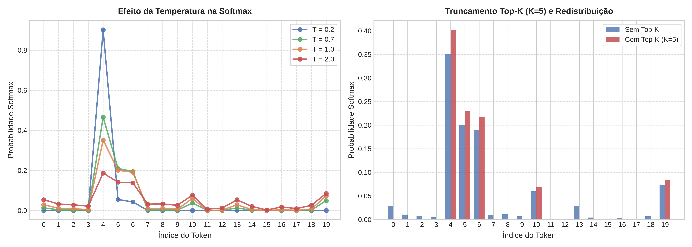

# Experimento 4.3: Controle de Aleatoriedade na Geração Autoregressiva (Temperatura e Top-K)

## Objetivo
Analisar o comportamento da distribuição de probabilidades gerada pela função Softmax sob diferentes valores de **Temperatura** ($T$) e com o truncamento por **Top-K**, compreendendo seu impacto na inferência autoregressiva.

## Metodologia
1. Vetores de *logits* brutos foram submetidos a diferentes configurações de temperatura:
   - $T = 0.2$ (Baixa temperatura / busca quase determinística)
   - $T = 0.7$ (Temperatura moderada / equilíbrio entre coerência e variedade)
   - $T = 1.0$ (Distribuição padrão do modelo)
   - $T = 2.0$ (Alta temperatura / alta dispersão)
2. Aplicou-se a estratégia de filtragem **Top-K** ($K = 5$), zerando a probabilidade de todos os tokens fora dos 5 maiores logits via preenchimento com $-\infty$.
3. Os perfis de probabilidade foram plotados e comparados.

## Imagem do Experimento

## Análise dos Resultados
* **Efeito da Temperatura:**
  * Para $T < 1.0$ (ex: $T = 0.2$), a distância entre o maior logit e os demais é amplificada. A curva de probabilidades torna-se extremamente pontiaguda, concentrando quase 100% da probabilidade no token de maior pontuação, aproximando-se do comportamento do *greedy search* (argmax).
  * Para $T > 1.0$ (ex: $T = 2.0$), a divisão reduz a magnitude relativa entre as pontuações, "achatando" a curva. Tokens antes considerados improváveis ganham probabilidade substancial, o que estimula maior diversidade léxica, mas aumenta o risco de incoerências gramaticais.
* **Efeito do Filtro Top-K ($K = 5$):**
  * O truncamento Top-K remove de forma categórica a cauda longa de tokens com baixa pontuação.
  * A normalização Softmax subsequente redistribui os 100% de probabilidade exclusivamente entre os $K$ candidatos mais prováveis. Isso previne que a amostragem estocástica selecione palavras desconexas, mantendo alta a plausibilidade local da sequência gerada.

## Conclusão
A combinação de **Temperatura** (calibrando a dispersão do sorteio) com **Top-K** (restringindo o espaço amostral aos melhores candidatos) fornece o controle ideal para a geração de texto em LLMs, equilibrando fluência gramatical, novidade e coerência conceitual.
