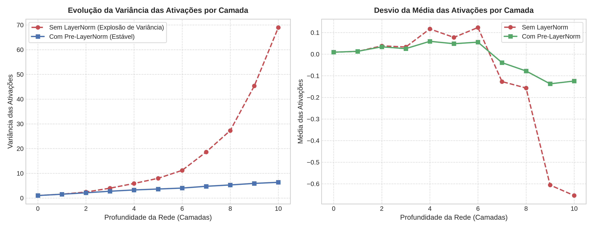

# Experimento 4.2: Estabilidade de Ativações com Pre-LayerNorm

## Objetivo
Investigar o papel da camada de normalização (*LayerNorm*) e da arquitetura *Pre-LayerNorm* na estabilização da média e da variância das ativações ao longo de uma rede profunda com conexões residuais.

## Metodologia
1. Foi simulada a passagem para a frente (*forward pass*) através de 10 blocos residuais empilhados com dimensão oculta $d_{model} = 128$.
2. Foram comparados dois cenários:
   - **Com Pre-LayerNorm:** Normalização aplicada à entrada antes de cada transformação de sub-bloco, somando-se à conexão residual ($x_{l+1} = x_l + F(\text{LayerNorm}(x_l))$).
   - **Sem LayerNorm:** Transformação aplicada diretamente sem pré-normalização ($x_{l+1} = x_l + F(x_l)$).
3. A cada camada, registraram-se a variância e a média das ativações resultantes.

## Imagem do Experimento

## Análise dos Resultados
* **Sem LayerNorm:**
  * A variância das ativações sofre crescimento cumulativo e acelerado à medida que novas camadas residuais são somadas ($x + F(x)$), ultrapassando ordens de magnitude superiores à variância inicial.
  * Esse descontrole na magnitude dos tensores causa o fenômeno de saturação precoce de gradientes, instabilidade de treinamento e desvios imprevisíveis da média das ativações.
* **Com Pre-LayerNorm:**
  * A variância das ativações permanece contida e previsível em torno de valores estáveis.
  * A média é preservada com desvios ínfimos em torno de zero ($0.0$).
  * A entrada em cada sub-bloco recebe tensores com escala padronizada, garantindo que nem as projeções de atenção nem as não-linearidades sofram distorções de magnitude.

## Conclusão
A adoção da técnica *Pre-LayerNorm* é fundamental para viabilizar o treinamento estável de LLMs profundos. Sem ela, a propagação do sinal através de dezenas de conexões residuais acumula variância excessiva, inviabilizando a convergência do modelo.
