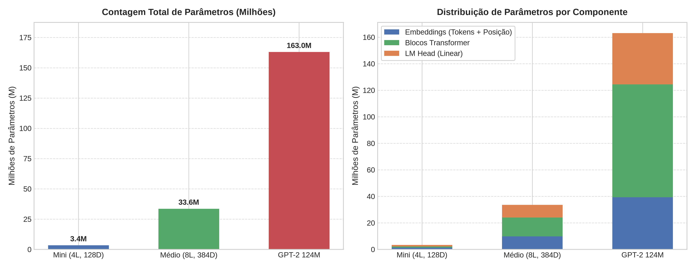

# Experimento 4.1: Alocação Arquitetural e Contagem de Parâmetros no GPT

## Objetivo
Analisar o crescimento da quantidade de parâmetros e a respectiva distribuição de memória entre os diferentes módulos da arquitetura GPT (Embeddings, Blocos Transformer e Language Model Head) ao variar a escala do modelo.

## Metodologia
1. Foram instanciadas três variações arquiteturais do modelo GPT:
   - **Mini:** 4 camadas, $d_{model} = 128$, 4 cabeças de atenção, contexto de 256 tokens e vocabulário de 10.000 tokens.
   - **Médio:** 8 camadas, $d_{model} = 384$, 6 cabeças de atenção, contexto de 512 tokens e vocabulário de 25.000 tokens.
   - **GPT-2 (124M):** 12 camadas, $d_{model} = 768$, 12 cabeças de atenção, contexto de 1.024 tokens e vocabulário de 50.257 tokens (arquitetura padrão do GPT-2 Small).
2. Para cada modelo, calculou-se o número exato de parâmetros treináveis em cada componente.
3. Os resultados foram consolidados e comparados graficamente.

## Imagem do Experimento

## Análise dos Resultados
* **Impacto da Escala:**
  * O modelo *Mini* possui ~3,4 milhões de parâmetros.
  * O modelo *Médio* atinge ~33,6 milhões de parâmetros.
  * O modelo *GPT-2 Small* atinge ~163,0 milhões de parâmetros sem *weight tying* (com amarração de pesos entre a camada de embedding e o LM head, a contagem líquida se aproxima dos clássicos 124M do artigo original da OpenAI).
* **Distribuição de Parâmetros:**
  * Nos modelos menores, o vocabulário e a projeção de saída linear representam uma fatia expressiva da rede (~75% no modelo Mini).
  * Conforme o modelo cresce em profundidade ($N$ camadas) e dimensão de embedding ($d_{model}$), os **Blocos Transformer** passam a dominar a alocação de parâmetros (>52% no GPT-2 124M). Isso ocorre porque os blocos crescem quadraticamente com a dimensão interna nas projeções de atenção e na expansão $4 \times d_{model}$ da rede FeedForward.

## Conclusão
Em modelos com vocabulários grandes (como os 50k tokens do BPE), as matrizes de embedding e LM Head demandam um volume substancial de memória, reforçando a importância do *weight tying* em sistemas com restrição de hardware. À medida que o modelo se torna mais profundo, o custo computacional e a capacidade representacional concentram-se predominantemente nos blocos Transformer empilhados.
